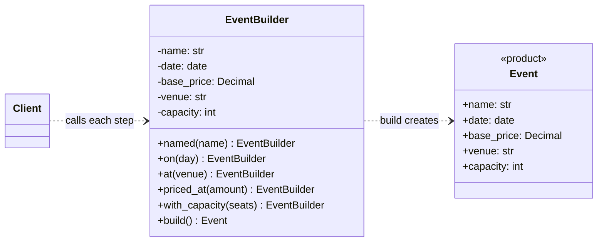
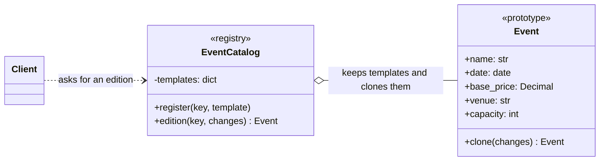
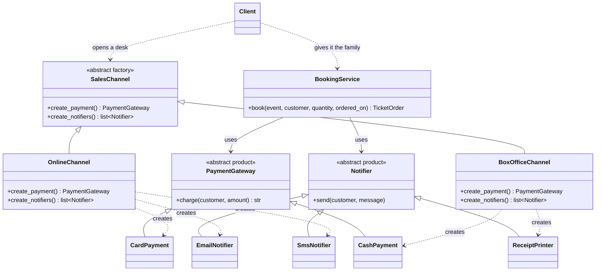

# Laboratory Work 2 — Creational Design Patterns

**Author:** Daniel Nicorici, FAF-243
**Language:** Python 3.10+ (standard library only)

## Objectives

1. Study the creational design patterns.
2. Implement three of them — **Builder**, **Prototype** and **Abstract Factory** — in a real project.
3. Keep the SOLID design from Lab 1 intact while the project grows.

## The project so far

This lab continues the event ticket booking system from [Lab 1](../lab1-solid). Lab 1 gave it a clean
booking flow (price → pay → save → notify) built on SRP, OCP and DIP. Lab 2 adds three real features,
and each one needed a creational pattern:

| New feature | Pattern |
|---|---|
| Organisers set up an event step by step: name, date, venue, price, capacity | **Builder** |
| The summit goes on tour: every city gets its own edition, copied from the original | **Prototype** |
| Tickets are sold online (card + email/SMS) and at the box office (cash + printed receipt) | **Abstract Factory** |

Events now also have a **capacity**: a booking that asks for more seats than are left is refused with
`SoldOut` before any money is charged.

```
lab2-creational/
├── main.py                  composition root + demo
├── ticketing/
│   ├── event_builder.py     EventBuilder                        ← Builder
│   ├── catalog.py           EventCatalog + Event.clone()        ← Prototype
│   ├── channels.py          SalesChannel, Online, BoxOffice     ← Abstract Factory
│   ├── models.py            Event (now with venue, capacity, validation, clone)
│   ├── payments.py          + CashPayment
│   ├── notifications.py     + ReceiptPrinter
│   ├── repository.py        + tickets_sold(event)
│   ├── service.py           + SoldOut check before payment
│   └── pricing.py, receipts.py   unchanged from Lab 1 (receipt shows the venue)
└── tests/
    ├── test_solid.py        Lab 1 tests, still passing
    └── test_creational.py   one test class per pattern + capacity
```

## Theory

Creational patterns deal with **how objects get created**, so that the code using an object does not
have to know how it is put together.

| Pattern | Idea in one line |
|---|---|
| Singleton | Only one instance of a class exists, with a global access point. |
| **Builder** | Build a complex object step by step and get it only when it is complete. |
| **Prototype** | Create new objects by copying an existing one instead of building from zero. |
| Object Pool | Reuse expensive objects (connections, threads) instead of creating new ones. |
| Factory Method | A subclass decides which concrete class a method creates. |
| **Abstract Factory** | One factory creates a whole family of related objects that must match. |

## Implementation

Each pattern below ends with its UML class diagram. How to read them:

| Arrow | Meaning |
|---|---|
| `A <\|-- B` (hollow triangle) | B inherits from / implements A |
| `A ..> B` (dashed arrow) | A creates or uses B |
| `A --> B` (solid arrow) | A holds a reference to B and calls it |
| `A o-- B` (hollow diamond) | A keeps a collection of B |

`Client` is `main.py`, the code that uses the pattern.

### 1. Builder — `ticketing/event_builder.py`

**Problem.** An event has five fields, three of which are required (name, date, price) and two that
have sensible defaults (venue, capacity). Building it with one long constructor call is easy to get
wrong, since `Event("Summit", d, Decimal("450"), "Arena", 300)` doesn't say which number is what.

**Solution.** `EventBuilder` collects the parts one step at a time. Each step returns the builder, so
the calls chain, and `build()` checks that every required step was done before it creates the
immutable `Event`:

```python
summit = (
    EventBuilder()
    .named("Moldova Tech Summit")
    .on(date(2026, 12, 5))
    .at("Chișinău Arena")
    .priced_at("450.00")
    .with_capacity(300)
    .build()
)
```

```python
def build(self) -> Event:
    required = {"name": self._name, "date": self._date, "price": self._base_price}
    missing = [step for step, value in required.items() if value is None]
    if missing:
        raise ValueError(f"Event is missing: {', '.join(missing)}")
    return Event(self._name, self._date, self._base_price, self._venue, self._capacity)
```

- Optional steps can be skipped: the venue defaults to "To be announced" and the capacity to 100.
- A missing step is reported by name (`Event is missing: date, price`).
- Value rules (no negative price, at least one seat) live in `Event.__post_init__`, the same way
  `TicketOrder` validated itself in Lab 1, so they also apply to clones.

**Why not plain keyword arguments?** They would cover readability, but the builder also lets the
event be filled in over several steps (like an organiser filling a form page by page) and refuses to
produce a half-made event.

**UML class diagram**



### 2. Prototype — `ticketing/models.py` + `ticketing/catalog.py`

**Problem.** The summit runs in several cities. Each edition shares the name and most settings with
the original and only changes a few things (date, venue, price, capacity). Rebuilding each one from
scratch repeats all the setup and lets editions drift apart by accident.

**Solution.** `Event` can copy itself, overriding only what is different:

```python
def clone(self, **changes) -> "Event":
    return replace(self, **changes)
```

`EventCatalog` is the **prototype registry**. It keeps template events under a key and hands out
copies, so the code that creates an edition never has to know how the original was built:

```python
catalog.register("tech-summit", summit)
balti = catalog.edition(
    "tech-summit",
    date=date(2027, 3, 12),
    venue="Bălți Palace of Culture",
    base_price=Decimal("350.00"),
    capacity=8,
)
```

- The template is never modified, so every edition starts from the same original.
- `dataclasses.replace` creates a brand-new object and runs `__post_init__` again, so a clone with
  `capacity=0` is rejected just like a built one.
- A shallow copy is enough here because every field of `Event` is immutable (str, date, Decimal, int).
  If events later get mutable parts (for example a list of ticket tiers), `clone` must switch to
  `copy.deepcopy` so editions don't share them.
- Each edition is a separate event, so it has its own seats: selling out Bălți doesn't touch
  Chișinău.

**UML class diagram**



### 3. Abstract Factory — `ticketing/channels.py`

**Problem.** The same booking can happen through two channels, and each channel needs a matching set
of parts:

| | Payment | Confirmation |
|---|---|---|
| Online | card | email + SMS |
| Box office | cash | printed receipt |

Wiring these by hand in `main.py` makes it easy to mix families by mistake, for example cash payment
with an SMS confirmation sent to a customer standing at the desk.

**Solution.** `SalesChannel` is the abstract factory. Every concrete channel creates its whole family,
so the parts always match:

```python
class SalesChannel(ABC):
    @abstractmethod
    def create_payment(self) -> PaymentGateway: ...

    @abstractmethod
    def create_notifiers(self) -> list[Notifier]: ...


class BoxOfficeChannel(SalesChannel):
    def create_payment(self):
        return CashPayment()

    def create_notifiers(self):
        return [ReceiptPrinter()]
```

`main.py` opens one booking desk per channel without naming a single concrete payment or notifier
class:

```python
def open_desk(channel: SalesChannel) -> BookingService:
    return BookingService(calculator, channel.create_payment(), repository, channel.create_notifiers(), receipts)

online = open_desk(OnlineChannel())
box_office = open_desk(BoxOfficeChannel())
```

This builds directly on Lab 1's Dependency Inversion: `BookingService` already depended only on
`PaymentGateway` and `Notifier`, so adding a whole new channel needed **no change to the service**.
A third channel (say, a mobile app with wallet + push notification) would be one new class.

**UML class diagram**



### Why not Singleton or Factory Method?

- **Singleton** would undo Lab 1. A global instance (for example one shared repository) can't be
  replaced with a fake in tests and hides a dependency that DIP made explicit in the constructor.
  Here, "only one repository" is guaranteed by creating it once in `main.py` and passing it in.
- **Factory Method** is partly inside the Abstract Factory already: `create_payment()` and
  `create_notifiers()` are factory methods that each subclass overrides. The Abstract Factory is the
  bigger pattern because it groups them into families.

## Running

```bash
python3 main.py              # demo: builder event, cloned edition, online + box office, sold out
python3 -m unittest -v       # 23 tests: 9 from Lab 1 + 14 for this lab
```

Demo output:

```
=== Online: early-bird student, 2 tickets, Chișinău ===
[email -> ana.rusu@example.com]
Order #1 confirmed: 2 x Moldova Tech Summit, Chișinău Arena, 05.12.2026
  Subtotal: 900.00 MDL
  Early bird discount: -180.00 MDL
  Student discount: -135.00 MDL
  Discounts capped at -270.00 MDL
  Total paid: 630.00 MDL
  Payment reference: CARD-0001

[sms -> +37360000001] Order #1 confirmed: 2 x Moldova Tech Summit, Chișinău Arena, 05.12.2026

=== Box office: group of 6, Bălți edition ===
[printer -> Ion Ceban]
Order #2 confirmed: 6 x Moldova Tech Summit, Bălți Palace of Culture, 12.03.2027
  Subtotal: 2100.00 MDL
  Group discount: -210.00 MDL
  Total paid: 1890.00 MDL
  Payment reference: CASH-0001

=== Online: 3 more tickets for Bălți (8 seats) ===
Sold out: Moldova Tech Summit, Bălți Palace of Culture: 2 seats left, 3 requested

Chișinău Arena: 2/300 seats sold
Bălți Palace of Culture: 6/8 seats sold
```

## Conclusions

The three creational patterns each solved a real problem that appeared as the ticketing system grew.
The Builder made event setup readable and refuses to hand out an incomplete event. The Prototype let
one configured event become a whole tour, with each edition overriding only what differs while the
original stays untouched. The Abstract Factory grouped payment and confirmation into matching
families, so online and box-office sales can't be mixed up. Because the Lab 1 design already
depended on abstractions, the new sales channel and the cloned events plugged into the existing
`BookingService` with only one addition, the capacity check, and all of Lab 1's tests still pass.
