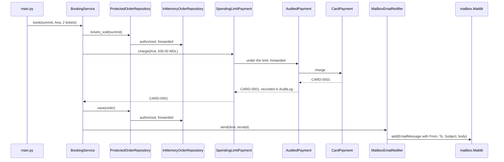
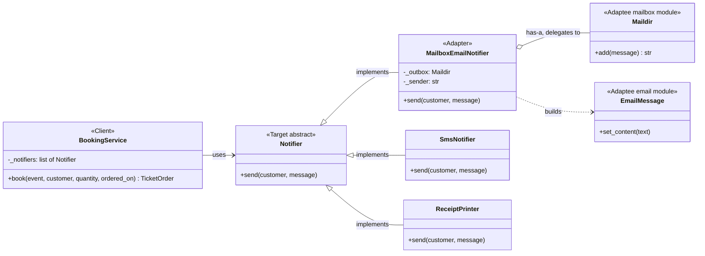
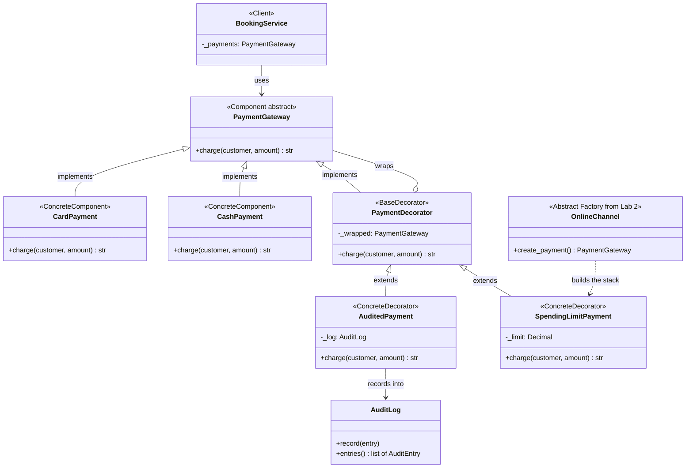
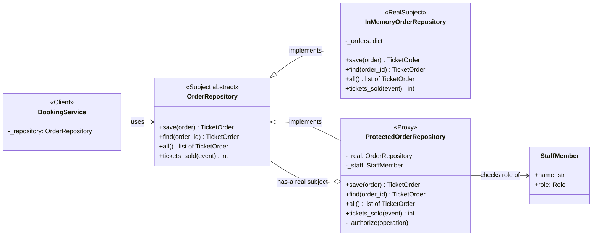

# Laboratory Work — Structural Design Patterns

**Author:** Daniel Nicorici, FAF-243
**Language:** Python 3 (standard library only)
**Patterns implemented:** Adapter, Decorator, Proxy

## 1. Domain description

The application is a ticket booking system for the "Moldova Tech Summit", which tours several cities.
An organizer creates the main event step by step (**Builder**) and clones it for each city
(**Prototype**). Tickets are sold through two sales channels, online and at the box office, and each
channel produces its own matching payment method and confirmation channel (**Abstract Factory**).
These three creational patterns come from the previous lab and still create every object used here.

A booking checks the free seats, prices the order with discounts (early bird, student, group, capped
at 30%), charges the customer, saves the order and sends the receipt.

This lab adds three real needs, each solved by a structural pattern:

| Real problem in this project | Pattern |
|---|---|
| Receipts must be delivered as real email through Python's `mailbox` / `email` library, whose API doesn't match our `Notifier` interface | **Adapter** |
| Online card payments need a spending limit, and every payment must be audited, without touching the payment classes | **Decorator** |
| Cashiers sell tickets but must not export the customer list (emails, phones); organizers can | **Proxy** |

The flat `ticketing` package from Lab 2 was split into `domain`, `services`, `creational` and
`structural` packages. Interfaces are abstract base classes (`abc.ABC` with `@abstractmethod`), and
private fields use the leading-underscore convention. All 23 tests from Labs 1–2 still pass.

### How the patterns work together

Every booking passes through all three structural patterns. The objects are built by the creational
patterns from Lab 2: `OnlineChannel` (Abstract Factory) creates the decorated payment stack and the
email adapter, and `main.py` wraps the repository in the proxy for the staff member at that desk.
`BookingService` only knows the abstract classes `OrderRepository`, `PaymentGateway` and `Notifier`.



This path is tested in [`tests/test_interaction.py`](tests/test_interaction.py) (section 2.4).

## 2. Patterns

### 2.1 Adapter — `MailboxEmailNotifier`

**Problem.** `BookingService` sends receipts through the `Notifier` interface:
`send(customer, message)`. Real email is handled by Python's **`mailbox`** and **`email`** modules,
library code we didn't design and cannot change. `mailbox.Maildir.add()` doesn't accept a customer and
a text: it needs a complete `EmailMessage` with `From`, `To` and `Subject` headers and a MIME body, and
returns a storage key. The adapter translates our call into the library's call, so `BookingService`
never learns how email is built or stored. A Maildir is the standard mail-folder format that mail
clients and mail servers read.

| Role | Class |
|---|---|
| Target | `Notifier` (abstract class) |
| Adapter | `MailboxEmailNotifier` |
| Adaptee | `mailbox.Maildir` + `email.message.EmailMessage` (Python's mail library) |
| Client | `BookingService` |

**Class diagram**



**Code** — [`ticketing/structural/adapter/mailbox_email_notifier.py`](ticketing/structural/adapter/mailbox_email_notifier.py#L9-L21)

```python
class MailboxEmailNotifier(Notifier):
    def __init__(self, outbox: mailbox.Maildir, sender: str):
        self._outbox = outbox
        self._sender = sender

    def send(self, customer: Customer, message: str) -> None:
        email = EmailMessage()
        email["From"] = self._sender
        email["To"] = formataddr((customer.name, customer.email))
        email["Subject"] = message.splitlines()[0]
        email.set_content(message)
        key = self._outbox.add(email)
        print(f'[email -> {customer.email}] "{email["Subject"]}" saved to outbox as {key}\n')
```

`send()` implements our interface and translates the data: the customer becomes the `To` address
(`"Ana Rusu <ana.rusu@example.com>"`), the first line of the receipt becomes the subject and the whole
receipt becomes the body. The library object is held, not inherited from, so the outbox can be any
Maildir, and swapping to SMTP delivery would mean one new adapter class.

**Unit tests** — [`tests/test_adapter.py`](tests/test_adapter.py)

| Test | What it proves |
|---|---|
| `test_translates_customer_and_receipt_into_an_email` | Reads the stored email back through the library: `From`, `To` (name + address), `Subject` (first receipt line) and body (full receipt) are correct. |
| `test_works_wherever_a_notifier_is_expected` | `BookingService` receives the adapter as a plain `list[Notifier]`, and a real booking stores an email with the booking's receipt. |
| `test_passes_library_failures_back_to_the_caller` | When the library fails (`OSError: disk full`), the error reaches the caller and nothing is stored. |

```
test_passes_library_failures_back_to_the_caller ... ok
test_translates_customer_and_receipt_into_an_email ... ok
test_works_wherever_a_notifier_is_expected ... ok
----------------------------------------------------------------------
Ran 3 tests in 0.003s

OK
```

### 2.2 Decorator — payment gateways

**Problem.** Two extra rules apply to payments: online card orders above 10,000 MDL must be declined
(fraud protection), and every successful payment, card or cash, must be written to an audit log for the
organizer. Putting these rules inside `CardPayment` and `CashPayment` would duplicate the audit code
and mix it with the payment logic. Subclasses like `AuditedLimitedCardPayment` would multiply with every
combination. Decorators wrap any gateway at runtime and can be combined freely.

| Role | Class |
|---|---|
| Component | `PaymentGateway` (abstract class) |
| Concrete components | `CardPayment`, `CashPayment` (and `WalletPayment` from Lab 1) |
| Base decorator | `PaymentDecorator` |
| Concrete decorators | `AuditedPayment`, `SpendingLimitPayment` |
| Client | `BookingService` |
| Built by | `OnlineChannel` / `BoxOfficeChannel` (Abstract Factory from Lab 2) |

**Class diagram**



**Code** — [`ticketing/structural/decorator/payment_decorator.py`](ticketing/structural/decorator/payment_decorator.py#L7-L12)
and [`ticketing/structural/decorator/spending_limit_payment.py`](ticketing/structural/decorator/spending_limit_payment.py#L14-L17)

```python
class PaymentDecorator(PaymentGateway):
    def __init__(self, wrapped: PaymentGateway):
        self._wrapped = wrapped

    def charge(self, customer: Customer, amount: Decimal) -> str:
        return self._wrapped.charge(customer, amount)


class SpendingLimitPayment(PaymentDecorator):
    # __init__ stores the limit
    def charge(self, customer: Customer, amount: Decimal) -> str:
        if amount > self._limit:
            raise PaymentDeclined(f"card payments are limited to {self._limit} MDL per order, got {amount} MDL")
        return super().charge(customer, amount)
```

The base decorator **is** a `PaymentGateway` and **has** a `PaymentGateway`, so a decorator can wrap a
real gateway or another decorator. Each concrete decorator adds its rule before or after
`super().charge()` and passes everything else through. The online channel builds
`SpendingLimitPayment(AuditedPayment(CardPayment(), log), limit)`, and the box office reuses
`AuditedPayment` around `CashPayment`.

**Design choice:** `AuditedPayment` records only successful charges. That keeps the two decorators
independent, so they give the same result in any order. If declined attempts also had to be audited,
the order would matter and `AuditedPayment` would have to be the outermost layer.

**Unit tests** — [`tests/test_decorator.py`](tests/test_decorator.py)

| Test | What it proves |
|---|---|
| `test_audited_payment_records_the_charge_and_returns_the_reference_unchanged` | The decorator adds behaviour (an audit entry) without changing the wrapped gateway's result. |
| `test_spending_limit_declines_over_limit_without_calling_the_wrapped_gateway` | An over-limit charge is stopped before it reaches the card; an amount exactly at the limit passes. |
| `test_decorators_stacked_in_either_order_give_the_same_result` | `Limit(Audit(card))` and `Audit(Limit(card))` both accept 300 MDL, decline 5,000 MDL, charge the card once and log one entry. |
| `test_a_new_decorator_is_a_new_class_only_and_stacks_with_the_existing_ones` | A `PrefixedReferencePayment` written inside the test extends `PaymentDecorator` and works in a 3-layer stack. Open/closed: no existing class changed. |

```
test_a_new_decorator_is_a_new_class_only_and_stacks_with_the_existing_ones ... ok
test_audited_payment_records_the_charge_and_returns_the_reference_unchanged ... ok
test_decorators_stacked_in_either_order_give_the_same_result ... ok
test_spending_limit_declines_over_limit_without_calling_the_wrapped_gateway ... ok
----------------------------------------------------------------------
Ran 4 tests in 0.000s

OK
```

### 2.3 Proxy — `ProtectedOrderRepository`

**Problem.** The order repository holds every customer's name, email and phone. Box-office cashiers
and the online shop need to save orders and count sold seats, but must not export the customer list.
The organizer needs that list for the event report. The storage class should not know about staff
roles, and `BookingService` should not change. A protection proxy with the **same interface** sits in
front of the real repository and checks each call against the staff member's role.

| Role | Class |
|---|---|
| Subject | `OrderRepository` (abstract class) |
| Real subject | `InMemoryOrderRepository` |
| Proxy | `ProtectedOrderRepository` |
| Client | `BookingService` (sales) and the organizer report in `main.py` |

**Class diagram**



**Code** — [`ticketing/structural/proxy/protected_order_repository.py`](ticketing/structural/proxy/protected_order_repository.py#L6-L35)

```python
PERMISSIONS = {
    Role.SELLER: {"save", "find", "tickets_sold"},
    Role.ORGANIZER: {"save", "find", "all", "tickets_sold"},
}


class ProtectedOrderRepository(OrderRepository):
    def __init__(self, real: OrderRepository, staff: StaffMember):
        self._real = real
        self._staff = staff

    # save, find and tickets_sold follow the same two lines
    def all(self) -> list[TicketOrder]:
        self._authorize("all")
        return self._real.all()

    def _authorize(self, operation: str) -> None:
        if operation not in PERMISSIONS[self._staff.role]:
            raise AccessDenied(f"{self._staff.name} ({self._staff.role.value}) may not call {operation}() on orders")
```

Each method checks permission first and then forwards the call to the real repository, returning its
result unchanged. Because the proxy inherits from `OrderRepository` and has the same methods,
`BookingService` receives it exactly like the real repository and doesn't know access is being checked.

**Unit tests** — [`tests/test_proxy.py`](tests/test_proxy.py)

| Test | What it proves |
|---|---|
| `test_passes_a_sellers_allowed_calls_through_unchanged` | `save`, `find` and `tickets_sold` return exactly what the real repository returns, and the order really is stored there. |
| `test_blocks_a_seller_from_exporting_customers_without_reaching_the_real_repository` | `all()` raises `AccessDenied`, and a spy shows the real `all()` was never called. |
| `test_gives_an_organizer_exactly_what_the_real_repository_returns` | The organizer's `all()` equals the real repository's `all()`. |

```
test_blocks_a_seller_from_exporting_customers_without_reaching_the_real_repository ... ok
test_gives_an_organizer_exactly_what_the_real_repository_returns ... ok
test_passes_a_sellers_allowed_calls_through_unchanged ... ok
----------------------------------------------------------------------
Ran 3 tests in 0.000s

OK
```

### 2.4 Interaction tests — [`tests/test_interaction.py`](tests/test_interaction.py)

| Test | What it proves |
|---|---|
| `test_an_online_booking_goes_through_the_proxy_the_decorators_and_the_adapter` | One booking, built by the Lab 2 `OnlineChannel` factory, is saved through the proxy, recorded by the audit decorator and stored as an email by the adapter. |
| `test_an_over_limit_booking_stops_in_the_decorator` | When `SpendingLimitPayment` declines, the path stops: the proxy never saves, the audit log stays empty and no email is stored. |

```
test_an_online_booking_goes_through_the_proxy_the_decorators_and_the_adapter ... ok
test_an_over_limit_booking_stops_in_the_decorator ... ok
----------------------------------------------------------------------
Ran 2 tests in 0.002s

OK
```

**Full suite** (`python3 -m unittest`): the 23 tests from Labs 1–2 plus these 12.

```
----------------------------------------------------------------------
Ran 35 tests in 0.006s

OK
```

### 2.5 The patterns not implemented

| Pattern | Where it could fit here | Why it wasn't chosen |
|---|---|---|
| Facade | A `TicketShop.buy()` hiding the catalog, channels and booking service | `BookingService` already gives one simple entry point; a facade over it would only forward calls. |
| Composite | A festival pass made of several event tickets, priced like one ticket | The project has no bundles yet, so it would be forced. |
| Bridge | Message type (confirmation, reminder) × channel (email, SMS) | There is only one message type, so one side of the bridge would have a single class. |
| Flyweight | Thousands of seats sharing one `SeatType` (section, price) | Tickets have no seat numbers yet; it fits once a seat map is added. |

## 3. Conclusions

**What was harder than expected**

- **Decorator order.** Decorators look independent, but an audit log that also recorded declined
  attempts would give different results depending on the order. I had to decide exactly what "audit"
  means before the "any order" property held.
- **Decorators break type checks.** The Lab 2 factory tests checked
  `isinstance(payment, CardPayment)`. Once the payment was wrapped in decorators that stopped being
  true, so the tests now check behaviour (a `CARD-` reference) instead of the class. Code that depends
  on the interface survives decoration; code that checks concrete types doesn't.
- **Where the proxy gets the user.** A protection proxy needs to know who is calling. With no login
  system, each desk creates its own proxy for its staff member. In a web app this would come from the
  request's session.
- **Restructuring the package.** Splitting the flat Lab 2 package into folders changed almost every
  import. Having all 23 old tests made it safe: they had to pass before any new pattern was added.

**What I would design differently**

- Python only enforces privacy by convention (`_name`). A language with real access modifiers would
  stop a client from reaching around the proxy to `_real`.
- Move permissions out of the code. The `PERMISSIONS` table is fine for two roles, but more roles
  would need a role/permission model loaded from configuration.
- Group the channel factories' growing constructor arguments (outbox, sender, audit log) into one
  configuration object.
