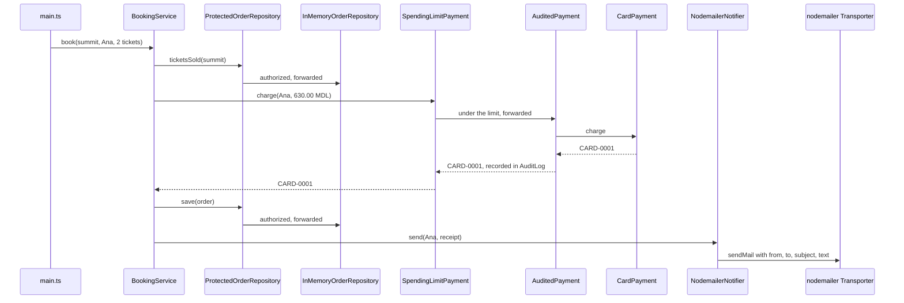
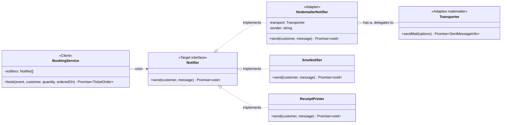
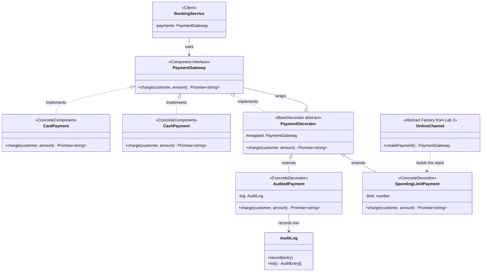
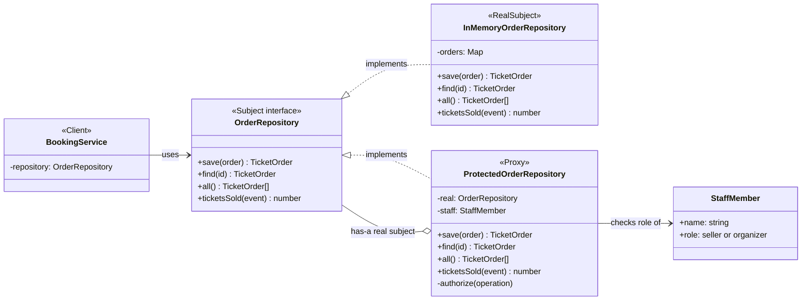

# Laboratory Work — Structural Design Patterns

**Author:** Daniel Nicorici, FAF-243
**Language:** TypeScript (Node.js 26, strict mode)
**Patterns implemented:** Adapter, Decorator, Proxy

## 1. Domain description

The application is a ticket booking system for the "Moldova Tech Summit", which tours several cities.
An organizer creates the main event step by step (**Builder**) and clones it for each city
(**Prototype**). Tickets are sold through two sales channels, online and at the box office, and each
channel produces its own matching payment method and confirmation channel (**Abstract Factory**).
These three creational patterns come from the previous lab and still create every object used here.

A booking checks the free seats, prices the order with discounts (early bird, student, group, capped
at 30%), charges the customer, saves the order and sends the receipt.

This lab adds three real needs, each solved by a structural pattern:

| Real problem in this project | Pattern |
|---|---|
| Receipts must go out by real email through `nodemailer`, a library whose API doesn't match our `Notifier` interface | **Adapter** |
| Online card payments need a spending limit, and every payment must be audited, without touching the payment classes | **Decorator** |
| Cashiers sell tickets but must not export the customer list (emails, phones); organizers can | **Proxy** |

> The previous labs were written in Python. This lab's brief requires a language with explicit
> interfaces, abstract classes and access modifiers, so the project was ported to TypeScript with the
> same classes and behaviour. The Lab 2 demo gives the same totals in both versions.

### How the patterns work together

Every booking passes through all three structural patterns. The objects are built by the creational
patterns from Lab 2: `OnlineChannel` (Abstract Factory) creates the decorated payment stack and the
email adapter, and `main.ts` wraps the repository in the proxy for the staff member at that desk.
`BookingService` only knows the interfaces `OrderRepository`, `PaymentGateway` and `Notifier`.



This path is tested in [`tests/interaction.test.ts`](tests/interaction.test.ts) (section 2.4).

## 2. Patterns

### 2.1 Adapter — `NodemailerNotifier`

**Problem.** `BookingService` sends receipts through the `Notifier` interface:
`send(customer, message)`. Real email goes through **nodemailer**, a third-party library we cannot
change, whose API is `transporter.sendMail({ from, to: { name, address }, subject, text })` and returns
delivery info. The adapter translates our call into the library's call, so `BookingService` never
learns that nodemailer exists.

| Role | Class |
|---|---|
| Target | `Notifier` (interface) |
| Adapter | `NodemailerNotifier` |
| Adaptee | `Transporter` from `nodemailer` (third-party library) |
| Client | `BookingService` |

**Class diagram**



**Code** — [`src/structural/adapter/nodemailer-notifier.ts`](src/structural/adapter/nodemailer-notifier.ts#L5-L24)

```ts
export class NodemailerNotifier implements Notifier {
  private readonly transport: Transporter;
  private readonly sender: string;

  constructor(transport: Transporter, sender: string) {
    this.transport = transport;
    this.sender = sender;
  }

  async send(customer: Customer, message: string): Promise<void> {
    const subject = message.split("\n")[0];
    const info = await this.transport.sendMail({
      from: this.sender,
      to: { name: customer.name, address: customer.email },
      subject,
      text: message,
    });
    console.log(`[email via nodemailer -> ${customer.email}] "${subject}" id ${info.messageId}\n`);
  }
}
```

`send()` implements our interface and translates the data: the customer becomes nodemailer's
`{ name, address }` recipient, the first line of the receipt becomes the subject and the whole receipt
becomes the body. The library object is held, not inherited from, so any nodemailer transport (the
demo's offline `jsonTransport` or a real SMTP server) works without changing this class.

**Unit tests** — [`tests/adapter.test.ts`](tests/adapter.test.ts)

| Test | What it proves |
|---|---|
| `translates customer + receipt into a nodemailer message` | Uses the real nodemailer library. The message it builds has the right `to` (name + address), `from`, `subject` (first receipt line) and `text` (full receipt). |
| `works wherever a Notifier is expected: a booking emails its receipt` | `BookingService` receives the adapter as a plain `Notifier[]` and a real booking produces an email with the booking's receipt. |
| `passes library delivery failures back to the caller` | When nodemailer fails (SMTP refused), the error reaches the caller instead of being swallowed. |

```
▶ Adapter: NodemailerNotifier adapts nodemailer to Notifier
  ✔ translates customer + receipt into a nodemailer message
  ✔ works wherever a Notifier is expected: a booking emails its receipt
  ✔ passes library delivery failures back to the caller
✔ Adapter: NodemailerNotifier adapts nodemailer to Notifier
ℹ tests 3
ℹ pass 3
ℹ fail 0
```

### 2.2 Decorator — payment gateways

**Problem.** Two extra rules apply to payments: online card orders above 10,000 MDL must be declined
(fraud protection), and every successful payment, card or cash, must be written to an audit log for the
organizer. Putting these rules inside `CardPayment` and `CashPayment` would duplicate the audit code
and mix it with the payment logic. Subclasses like `AuditedLimitedCardPayment` would multiply with every
combination. Decorators wrap any gateway at runtime and can be combined freely.

| Role | Class |
|---|---|
| Component | `PaymentGateway` (interface) |
| Concrete components | `CardPayment`, `CashPayment` |
| Base decorator | `PaymentDecorator` (abstract class) |
| Concrete decorators | `AuditedPayment`, `SpendingLimitPayment` |
| Client | `BookingService` |
| Built by | `OnlineChannel` / `BoxOfficeChannel` (Abstract Factory from Lab 2) |

**Class diagram**



**Code** — [`src/structural/decorator/payment-decorator.ts`](src/structural/decorator/payment-decorator.ts#L4-L14)
and [`src/structural/decorator/spending-limit-payment.ts`](src/structural/decorator/spending-limit-payment.ts#L15-L20)

```ts
export abstract class PaymentDecorator implements PaymentGateway {
  protected readonly wrapped: PaymentGateway;

  constructor(wrapped: PaymentGateway) {
    this.wrapped = wrapped;
  }

  charge(customer: Customer, amount: number): Promise<string> {
    return this.wrapped.charge(customer, amount);
  }
}

// SpendingLimitPayment
  override async charge(customer: Customer, amount: number): Promise<string> {
    if (amount > this.limit) {
      throw new PaymentDeclined(`card payments are limited to ${formatMdl(this.limit)} per order, got ${formatMdl(amount)}`);
    }
    return super.charge(customer, amount);
  }
```

The base decorator **is** a `PaymentGateway` and **has** a `PaymentGateway`, so a decorator can wrap a
real gateway or another decorator. Each concrete decorator adds its rule before or after
`super.charge()` and passes everything else through. The online channel builds
`new SpendingLimitPayment(new AuditedPayment(new CardPayment(), log), limit)`, and the box office reuses
`AuditedPayment` around `CashPayment`.

**Design choice:** `AuditedPayment` records only successful charges. That keeps the two decorators
independent, so they give the same result in any order. If declined attempts also had to be audited,
the order would matter and `AuditedPayment` would have to be the outermost layer.

**Unit tests** — [`tests/decorator.test.ts`](tests/decorator.test.ts)

| Test | What it proves |
|---|---|
| `AuditedPayment records the charge and returns the wrapped reference unchanged` | The decorator adds behaviour (an audit entry) without changing the wrapped gateway's result. |
| `SpendingLimitPayment declines an over-limit amount without calling the wrapped gateway` | An over-limit charge is stopped before it reaches the card; an amount exactly at the limit passes. |
| `decorators stacked in either order give the same result` | `Limit(Audit(card))` and `Audit(Limit(card))` both accept 300 MDL, decline 5,000 MDL, charge the card once and log one entry. |
| `a new decorator is added as a new class only and stacks with the existing ones` | A `PrefixedReferencePayment` written inside the test extends `PaymentDecorator` and works in a 3-layer stack. Open/closed: no existing class changed. |

```
▶ Decorator: payment gateways wrapped with extra responsibilities
  ✔ AuditedPayment records the charge and returns the wrapped reference unchanged
  ✔ SpendingLimitPayment declines an over-limit amount without calling the wrapped gateway
  ✔ decorators stacked in either order give the same result
  ✔ a new decorator is added as a new class only and stacks with the existing ones
✔ Decorator: payment gateways wrapped with extra responsibilities
ℹ tests 4
ℹ pass 4
ℹ fail 0
```

### 2.3 Proxy — `ProtectedOrderRepository`

**Problem.** The order repository holds every customer's name, email and phone. Box-office cashiers
and the online shop need to save orders and count sold seats, but must not export the customer list.
The organizer needs that list for the event report. The storage class should not know about staff
roles, and `BookingService` should not change. A protection proxy with the **same interface** sits in
front of the real repository and checks each call against the staff member's role.

| Role | Class |
|---|---|
| Subject | `OrderRepository` (interface) |
| Real subject | `InMemoryOrderRepository` |
| Proxy | `ProtectedOrderRepository` |
| Client | `BookingService` (sales) and the organizer report in `main.ts` |

**Class diagram**



**Code** — [`src/structural/proxy/protected-order-repository.ts`](src/structural/proxy/protected-order-repository.ts#L8-L46)

```ts
const PERMISSIONS: Record<Role, ReadonlySet<Operation>> = {
  seller: new Set<Operation>(["save", "find", "ticketsSold"]),
  organizer: new Set<Operation>(["save", "find", "all", "ticketsSold"]),
};

export class ProtectedOrderRepository implements OrderRepository {
  // ...
  all(): readonly TicketOrder[] {
    this.authorize("all");
    return this.real.all();
  }

  ticketsSold(event: Event): number {
    this.authorize("ticketsSold");
    return this.real.ticketsSold(event);
  }

  private authorize(operation: Operation): void {
    if (!PERMISSIONS[this.staff.role].has(operation)) {
      throw new AccessDenied(`${this.staff.name} (${this.staff.role}) may not call ${operation}() on orders`);
    }
  }
}
```

Each method checks permission first and then forwards the call to the real repository, returning its
result unchanged. Because the proxy implements `OrderRepository`, `BookingService` receives it exactly
like the real repository and doesn't know access is being checked.

**Unit tests** — [`tests/proxy.test.ts`](tests/proxy.test.ts)

| Test | What it proves |
|---|---|
| `passes a seller's allowed calls through to the real repository unchanged` | `save`, `find` and `ticketsSold` return exactly what the real repository returns, and the order really is stored there. |
| `blocks a seller from exporting the customer list without reaching the real repository` | `all()` throws `AccessDenied`, and a spy shows the real `all()` was never called. |
| `gives an organizer exactly what the real repository returns` | The organizer's `all()` equals the real repository's `all()`. |

```
▶ Proxy: ProtectedOrderRepository controls access to orders
  ✔ passes a seller's allowed calls through to the real repository unchanged
  ✔ blocks a seller from exporting the customer list without reaching the real repository
  ✔ gives an organizer exactly what the real repository returns
✔ Proxy: ProtectedOrderRepository controls access to orders
ℹ tests 3
ℹ pass 3
ℹ fail 0
```

### 2.4 Interaction tests — [`tests/interaction.test.ts`](tests/interaction.test.ts)

| Test | What it proves |
|---|---|
| `an online booking goes through the Proxy, the Decorators and the Adapter` | One booking, built by the Lab 2 `OnlineChannel` factory, is saved through the proxy, recorded by the audit decorator and emailed through the nodemailer adapter. |
| `an over-limit booking stops in the Decorator: nothing saved, audited or emailed` | When `SpendingLimitPayment` declines, the path stops: the proxy never saves, the audit log stays empty and no email is sent. |

```
▶ Patterns working together in one booking
  ✔ an online booking goes through the Proxy, the Decorators and the Adapter
  ✔ an over-limit booking stops in the Decorator: nothing saved, audited or emailed
✔ Patterns working together in one booking
ℹ tests 2
ℹ pass 2
ℹ fail 0
```

**Full suite** (`npm test`: type-check + all tests):

```
✔ Adapter: NodemailerNotifier adapts nodemailer to Notifier
✔ core booking (ported from Labs 1-2)
✔ creational patterns reused from Lab 2
✔ Decorator: payment gateways wrapped with extra responsibilities
✔ Patterns working together in one booking
✔ Proxy: ProtectedOrderRepository controls access to orders
ℹ tests 17
ℹ pass 17
ℹ fail 0
```

### 2.5 The patterns not implemented

| Pattern | Where it could fit here | Why it wasn't chosen |
|---|---|---|
| Facade | A `TicketShop.buy()` hiding the catalog, channels and booking service | `BookingService` already gives one simple entry point; a facade over it would only forward calls. |
| Composite | A festival pass made of several event tickets, priced like one ticket | The project has no bundles yet, so it would be forced. |
| Bridge | Message type (confirmation, reminder) × channel (email, SMS) | There is only one message type, so one side of the bridge would have a single class. |
| Flyweight | Thousands of seats sharing one `SeatType` (section, price) | Tickets have no seat numbers yet; it fits once a seat map is added. |

## 3. Conclusions

**What was harder than expected**

- **Async spreads.** nodemailer is asynchronous, so `Notifier.send` had to return a `Promise`.
  Payments were made async for the same reason (a real card network is a remote call), and so
  `BookingService.book` became async too. One real library changed three interfaces.
- **Decorator order.** Decorators look independent, but an audit log that also recorded declined
  attempts would give different results depending on the order. I had to decide exactly what "audit"
  means before the "any order" property held.
- **Where the proxy gets the user.** A protection proxy needs to know who is calling. With no login
  system, each desk creates its own proxy for its staff member. In a web app this would come from the
  request's session.
- **Porting from Python.** Python isn't allowed for this lab, so the project was rewritten in TypeScript.
  Running TypeScript directly on Node also rules out constructor parameter properties, so fields are
  declared explicitly.

**What I would design differently**

- Make `OrderRepository` async from the start. A real database is asynchronous, and swapping the
  in-memory store for one would now change the interface, the proxy and the service.
- Move permissions out of the code. The `PERMISSIONS` table is fine for two roles, but more roles
  would need a role/permission model loaded from configuration.
- Group the channel factories' growing constructor arguments (mailer, sender, audit log) into one
  configuration object.
