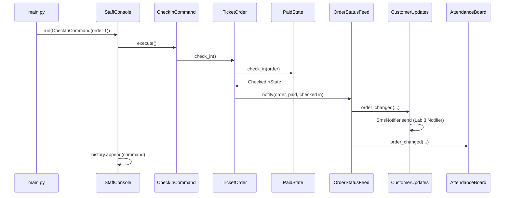
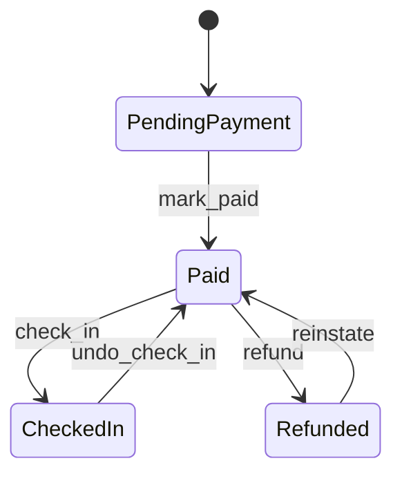
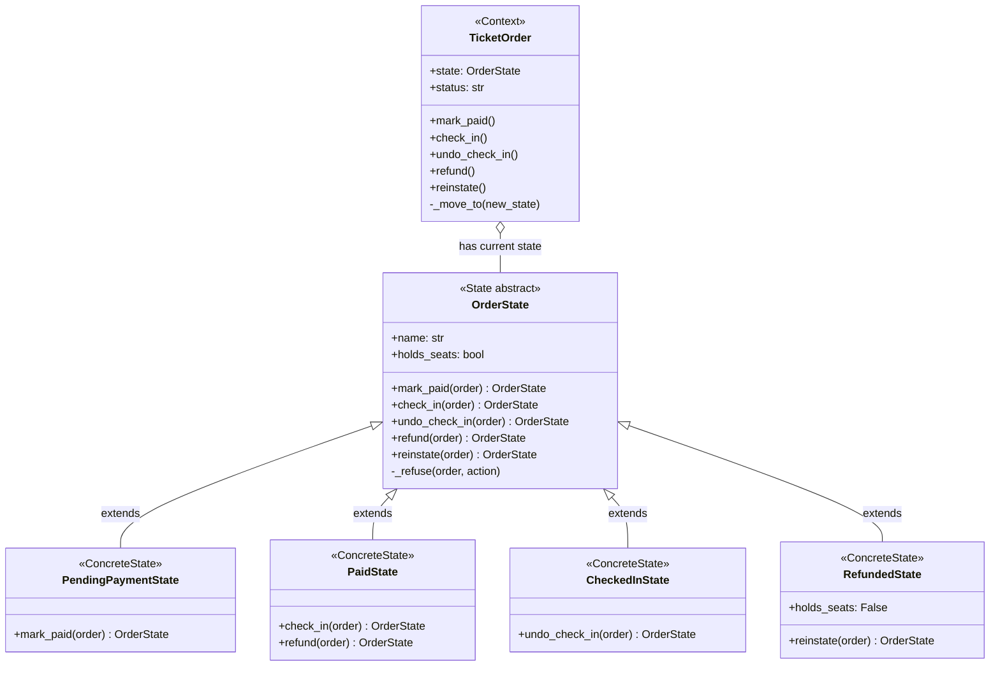
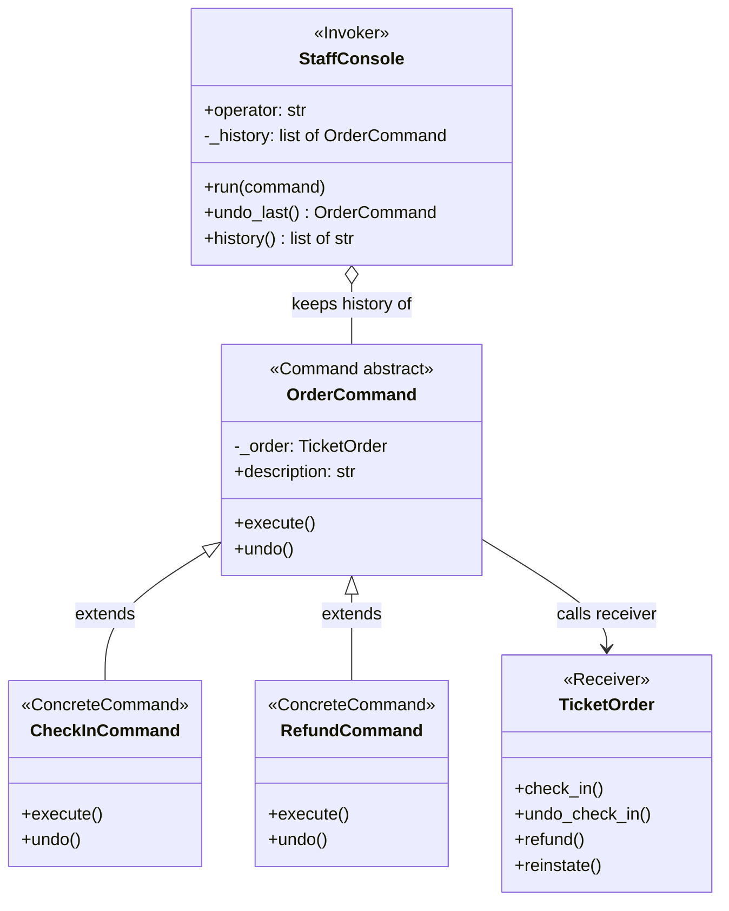
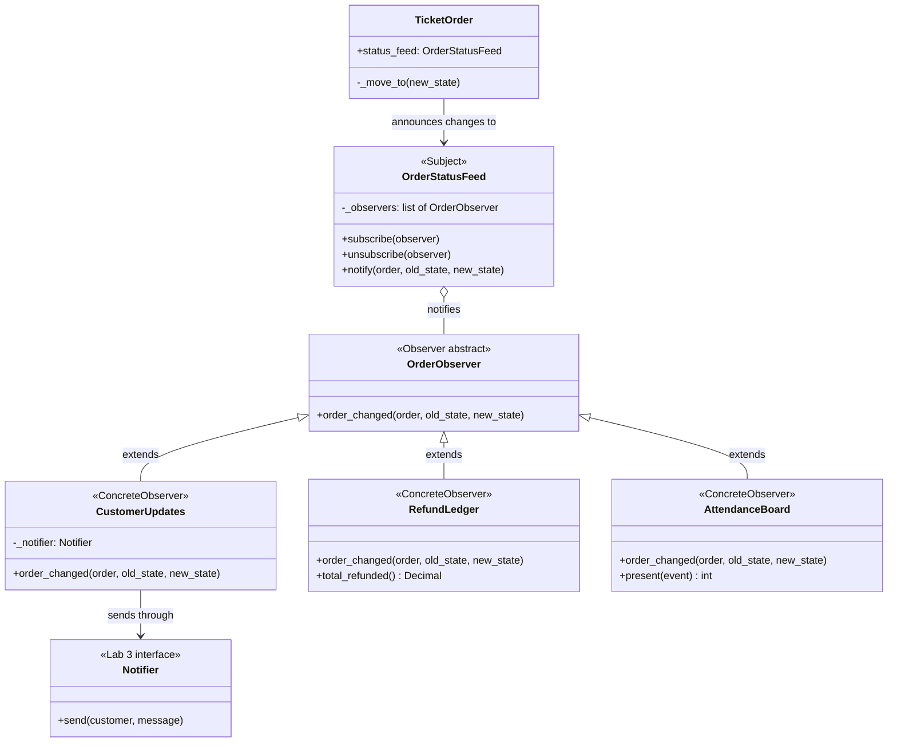

# Laboratory Work — Behavioral Design Patterns

**Author:** Daniel Nicorici, FAF-243
**Language:** Python 3 (standard library only)
**Patterns implemented:** State, Command, Observer

## 1. Domain description

The application is a ticket booking system for the "Moldova Tech Summit", which tours several cities.
Events are created with a **Builder** and cloned per city with a **Prototype**; tickets are sold
online and at the box office through **Abstract Factory** sales channels (Lab 2). Payments are wrapped
in **Decorators**, receipts are emailed through an **Adapter**, and the order list is guarded by a
**Proxy** (Lab 3). All of that is reused here unchanged.

This lab covers what happens to an order **after it is sold**:

| Real problem in this project | Pattern |
|---|---|
| An order must behave differently depending on where it is in its life: a refunded ticket can't be checked in, a used ticket can't be refunded, and only some orders hold seats | **State** |
| Door and support staff perform actions on orders that must be logged and sometimes undone (a wrong ticket scanned, a refund issued by mistake) | **Command** |
| Several parts of the system react to the same status change: the customer gets an SMS, accounting records refunds, the door counts attendance. They must be added and removed without touching the order | **Observer** |

### How the patterns work together

When the door scanner checks a ticket in, one call passes through all three patterns and two Lab 3
patterns as well:



The order is found through the Lab 3 **Proxy** (`ProtectedOrderRepository.find`), and a refund changes
`holds_seats`, so the next booking's seat check, also done through the Proxy, sees the freed seats.
This path is tested in [`tests/test_order_flow.py`](tests/test_order_flow.py) (section 2.4).

### Behaviour that changes at runtime

- Observers are **subscribed and unsubscribed while the app runs**: in demo section 13 the organizer
  turns off customer SMS updates, and the next check-in is still counted at the door but sends no SMS.
- Each order **moves between states at runtime** in response to staff commands, and its behaviour
  changes with it (section 9: the same scan is accepted once and rejected the second time).
- Each `StaffConsole` keeps a **history that can be undone** step by step (section 10).

## 2. Patterns

### 2.1 State — the order lifecycle

**Problem.** Without State, every action on an order would need an `if status == ...` chain: check-in
must refuse refunded and already-used tickets, refund must refuse used tickets, and seat counting must
skip refunded orders. Every new status would mean editing all of those branches. With State, each
status is a class that knows which actions it allows and which state comes next.

| Role | Class |
|---|---|
| Context | `TicketOrder` |
| State | `OrderState` (abstract class) |
| Concrete states | `PendingPaymentState`, `PaidState`, `CheckedInState`, `RefundedState` |

**Transitions**



Any action not drawn here raises `InvalidTransition` and leaves the state unchanged.

**Class diagram**



**Code** — [`ticketing/behavioral/state/order_states.py`](ticketing/behavioral/state/order_states.py#L34-L53)
and [`ticketing/domain/models.py`](ticketing/domain/models.py#L62-L77)

```python
class OrderState(ABC):
    # every action refuses by default
    def _refuse(self, order: TicketOrder, action: str) -> OrderState:
        raise InvalidTransition(f"Order #{order.id} is {self.name}: cannot {action}")


class PaidState(OrderState):
    name = "paid"

    def check_in(self, order):
        return CheckedInState()

    def refund(self, order):
        return RefundedState()


class TicketOrder:
    def check_in(self) -> None:
        self._move_to(self.state.check_in(self))

    def _move_to(self, new_state: OrderState) -> None:
        old_state, self.state = self.state, new_state
        if self.status_feed is not None:
            self.status_feed.notify(self, old_state, new_state)
```

The context never checks its own status: it asks the current state object, which either returns the
next state or refuses. Each concrete state overrides only the moves it allows, so the rules for
"paid" live in one class, and a new status is a new class.

**Unit tests** — [`tests/test_state.py`](tests/test_state.py)

| Test | What it proves |
|---|---|
| `test_valid_transitions_follow_the_lifecycle` | pending → paid → checked in → paid → refunded → paid, with the right status after every step. |
| `test_forbidden_transitions_are_rejected_and_leave_the_state_unchanged` | Checking in a pending, already checked-in or refunded order, and refunding a used ticket, all raise `InvalidTransition`, and the status stays the same. |
| `test_a_refunded_order_releases_its_seats` | After a refund, `tickets_sold` drops from 5 to 2, because `RefundedState.holds_seats` is `False`. |

```
test_a_refunded_order_releases_its_seats ... ok
test_forbidden_transitions_are_rejected_and_leave_the_state_unchanged ... ok
test_valid_transitions_follow_the_lifecycle ... ok
Ran 3 tests in 0.000s
OK
```

### 2.2 Command — staff actions with history and undo

**Problem.** Door and support staff act on orders: check a ticket in, refund an order. Mistakes happen
(the wrong ticket is scanned, a refund is issued to the wrong person), so each action must be
recorded and reversible. Turning each action into an object gives one place to run it, log it and undo
it, while the actual rules stay in the order (the receiver).

| Role | Class |
|---|---|
| Command | `OrderCommand` (abstract class) |
| Concrete commands | `CheckInCommand`, `RefundCommand` |
| Invoker | `StaffConsole` (keeps the history, runs and undoes) |
| Receiver | `TicketOrder` |
| Client | `main.py` (creates commands for the door and support consoles) |

**Class diagram**



**Code** — [`ticketing/behavioral/command/order_commands.py`](ticketing/behavioral/command/order_commands.py#L21-L30)
and [`ticketing/behavioral/command/staff_console.py`](ticketing/behavioral/command/staff_console.py#L9-L19)

```python
class CheckInCommand(OrderCommand):
    @property
    def description(self) -> str:
        return f"check in order #{self._order.id}"

    def execute(self) -> None:
        self._order.check_in()

    def undo(self) -> None:
        self._order.undo_check_in()


class StaffConsole:
    def run(self, command: OrderCommand) -> None:
        command.execute()
        self._history.append(command)

    def undo_last(self) -> OrderCommand | None:
        if not self._history:
            return None
        command = self._history[-1]
        command.undo()
        self._history.pop()
        return command
```

Each command is an `execute`/`undo` pair that only calls the receiver; the business rules stay in the
order and its states. The console records a command only after it succeeds and removes it only after
its undo succeeds, so a rejected action never appears in the history.

**Unit tests** — [`tests/test_command.py`](tests/test_command.py)

| Test | What it proves |
|---|---|
| `test_executing_and_undoing_a_command_restores_the_original_state` | For both commands, execute changes the status and undo brings it back to `paid`. |
| `test_history_keeps_only_executed_commands_and_undo_is_last_in_first_out` | A rejected refund isn't recorded; `undo_last` reverses the most recent command and leaves the earlier one. |
| `test_undo_with_an_empty_history_does_nothing` | Undo on a fresh console returns `None` instead of crashing. |

```
test_executing_and_undoing_a_command_restores_the_original_state ... ok
test_history_keeps_only_executed_commands_and_undo_is_last_in_first_out ... ok
test_undo_with_an_empty_history_does_nothing ... ok
Ran 3 tests in 0.000s
OK
```

### 2.3 Observer — the order status feed

**Problem.** When an order changes status, several unrelated parts of the system care: the customer
should get an SMS, accounting must record refunds, and the door wants a live attendance count. If the
order called each of them directly, it would depend on all of them and every new listener would mean
editing `TicketOrder`. With Observer, the order only announces the change, and listeners subscribe or
unsubscribe on their own, even while the app runs.

| Role | Class |
|---|---|
| Subject | `OrderStatusFeed` |
| Observer | `OrderObserver` (abstract class) |
| Concrete observers | `CustomerUpdates`, `RefundLedger`, `AttendanceBoard` |
| Announcer | `TicketOrder._move_to()` calls `notify` after every state change |

**Class diagram**



**Code** — [`ticketing/behavioral/observer/order_status_feed.py`](ticketing/behavioral/observer/order_status_feed.py#L16-L30)

```python
class OrderStatusFeed:
    def __init__(self):
        self._observers: list[OrderObserver] = []

    def subscribe(self, observer: OrderObserver) -> None:
        if observer not in self._observers:
            self._observers.append(observer)

    def unsubscribe(self, observer: OrderObserver) -> None:
        if observer in self._observers:
            self._observers.remove(observer)

    def notify(self, order: TicketOrder, old_state: OrderState, new_state: OrderState) -> None:
        for observer in list(self._observers):
            observer.order_changed(order, old_state, new_state)
```

The feed only knows the `OrderObserver` interface, never the concrete classes. `notify` loops over a
copy of the list, so an observer can unsubscribe during a notification safely. Observers only read the
order and never change its state, so a notification can't trigger another one in a loop.

**Unit tests** — [`tests/test_observer.py`](tests/test_observer.py)

| Test | What it proves |
|---|---|
| `test_all_subscribed_observers_are_notified_and_unsubscribed_ones_are_not` | Two observers hear the check-in; after one unsubscribes, only the other hears the undo. |
| `test_customer_updates_send_each_change_through_the_notifier` | A refund produces exactly one message to the right customer: `paid -> refunded`. |
| `test_ledger_and_attendance_board_track_their_own_changes` | The board counts 3 people after check-in and 0 after undo; the ledger records the refund and its reversal, totalling 0. |

```
test_all_subscribed_observers_are_notified_and_unsubscribed_ones_are_not ... ok
test_customer_updates_send_each_change_through_the_notifier ... ok
test_ledger_and_attendance_board_track_their_own_changes ... ok
Ran 3 tests in 0.000s
OK
```

### 2.4 Interaction tests — [`tests/test_order_flow.py`](tests/test_order_flow.py)

| Test | What it proves |
|---|---|
| `test_a_refund_command_changes_the_state_and_every_observer_hears_it` | An order booked through `BookingService` and found through the Lab 3 Proxy is refunded by a `RefundCommand`: the state becomes `refunded`, the ledger records 300 MDL, the customer is told, and the seats are released. Undo reverses all of it. |
| `test_a_rejected_command_changes_nothing_and_notifies_nobody` | Checking in a refunded order fails in the State, so no observer is notified and nothing enters the console history. |

```
test_a_refund_command_changes_the_state_and_every_observer_hears_it ... ok
test_a_rejected_command_changes_nothing_and_notifies_nobody ... ok
Ran 2 tests in 0.000s
OK
```

**Full suite** (`python3 -m unittest`): 35 tests from Labs 1–3 plus these 11.

```
Ran 46 tests in 0.010s

OK
```

### 2.5 The patterns not implemented

| Pattern | Where it could fit here | Why it wasn't chosen |
|---|---|---|
| Strategy | `DiscountPolicy` (Lab 1) is already a family of interchangeable pricing algorithms | It exists from Lab 1, so it isn't counted as new work here. |
| Chain of Responsibility | Booking checks as a chain: valid order → seats → spending limit → payment | Today there are only two fixed checks; a chain would be forced. |
| Memento | Save a snapshot of an order or cart before editing, restore it later | Our undo reverses each action through its command, so snapshots aren't needed. |
| Iterator | Walk a seat map row by row, or all orders of one event | Python's loops and generators already cover this; a custom iterator would only wrap them. |
| Mediator | A checkout screen where seat picker, coupon box and price box coordinate | The app is a console demo with no interacting widgets. |
| Template Method | Exports with fixed steps (header, rows, totals) in CSV or PDF | There are no exports yet. |
| Visitor | New operations (tax report, statistics) over Event / Order / Seat | The object hierarchy is too small to justify double dispatch. |
| Interpreter | Promo rules written as text, e.g. `STUDENT AND EARLY` | Good to know; not part of the required three. |

## 3. Conclusions

**What was harder than expected**

- **Who announces the change.** Commands could notify observers themselves, but then a status change
  made any other way would go unannounced. Putting the `notify` call in the context's single
  `_move_to()` method means every transition is announced, however it was triggered.
- **Avoiding double messages.** The new order's first transition (pending → paid) happens during
  booking, when the customer already gets a receipt. The booking service attaches the status feed
  only after the order is paid and saved, so customers aren't messaged twice.
- **Circular imports in Python.** The order needs its state classes, and the states and observers
  mention the order in their type hints. `TYPE_CHECKING` imports were needed to break the cycle.

**What I would design differently**

- **Reinstating a refund can oversell.** If the freed seats are sold again (as in the demo, where Maria
  buys them), undoing the original refund would put the event over capacity. The undo should check free
  seats first, through the booking service, rather than only asking the order's state.
- The observers receive `(order, old_state, new_state)`. A dedicated event object (`OrderStatusChanged`
  with a timestamp and the staff member) would make the history easier to store and replay.
- The two consoles each keep their own history. A shared, persisted log would let a supervisor see and
  undo actions across the whole venue.
